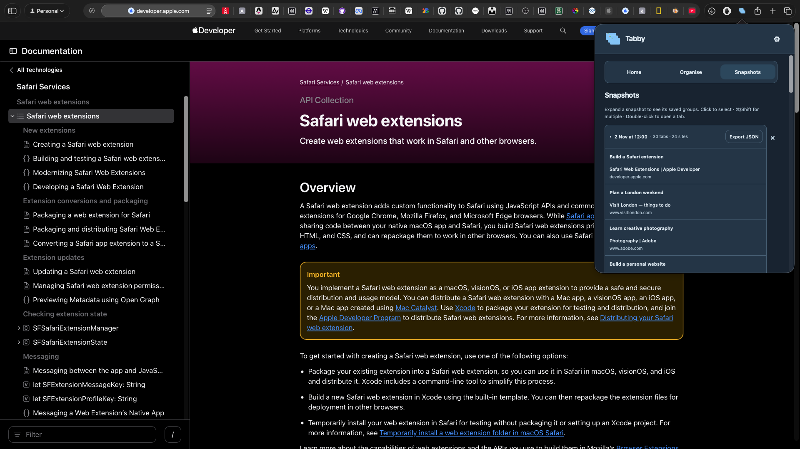
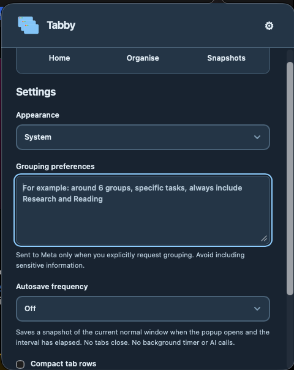
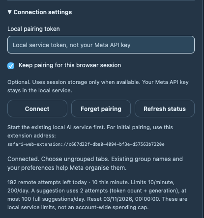

<p align="center">
  
</p>

<h1 align="center">Tabby</h1>

<p align="center">Turn open Safari tabs into focused workspaces with Meta AI.<br>Find a tab, organise a project, and save your place for later.</p>

<p align="center">
  <a href="https://github.com/Jyosnorkel/tabby/releases">Download</a> ·
  <a href="#get-started">Get started</a> ·
  <a href="docs/INSTALL.md">Installation guide</a> ·
  <a href="https://github.com/Jyosnorkel/tabby/issues">Issues</a>
</p>


## Download

### macOS

[Download the developer preview](https://github.com/Jyosnorkel/tabby/releases/tag/dev-checkpoint-2026-11-02).

The current preview targets **Apple silicon and macOS 26.5 or newer**. Unzip the download, move **Safari Dev Lab.app** to Applications, and open it. The app displays as **Tabby**.

This is an ad-hoc development build, not a notarized installer. Safari requires **Allow Unsigned Extensions** and Tabby must be enabled in **Safari Settings → Extensions**. Normal Gatekeeper installation is not established; see the [installation guide](docs/INSTALL.md) for requirements and the source-build alternative.

## Get started

1. Open Tabby from Safari's toolbar. Search your tabs or create a group in **Organise**.
2. Drag tabs between groups and reorder them to suit your work.
3. Choose **Save snapshot** to keep a copy of the current window without closing tabs.
4. Return to **Snapshots** to browse saved work, open saved tabs or export a JSON backup.

Manual organisation, search and snapshots work without an AI account.

### Organise with Meta AI

Enter your Meta API key in the desktop app, explicitly enable AI and start the local connection. Copy the separate connection token into **Local AI connection** in the Safari popup. Keep the desktop app running while using AI.

Choose **AI organise**, preview the information being shared and give consent. Meta receives included ungrouped tabs, your grouping preferences, and existing group names and counts. Matching suggestions add tabs to existing groups while preserving your manual organisation.

The popup applies validated results after consent; you can rename groups and move tabs afterwards. The dashboard also offers staged review before acceptance. No model request runs automatically on startup or refresh.

[AI setup guide](docs/meta-setup.md)

## Find your tabs

Search titles or websites and switch to a tab you already have open. Use the keyboard or select several tabs to organise them together.

<p align="center">
  
</p>

## Save your place

Save ordered titles and URLs locally. Export portable JSON backups, import them without replacing existing snapshots, or drop a backup into Tabby to restore its URLs in a new normal window.

The workspace dashboard also supports save-and-close, ordered restoration, partial-operation recovery and explicitly confirmed Safari tab clustering with guarded undo.

Restoration reopens URLs. It does not recover unsaved forms, scroll positions, authentication, history or full page state. Tabby's groups are separate from native Safari Tab Groups.



## Make it yours

Choose light, dark or system appearance, compact rows and grouping preferences. Optional automatic snapshots run when you open the popup after your chosen interval; they do not close tabs or make AI calls.

<p align="center">
  
</p>

<details>
<summary>More screenshots</summary>

### Home


### Local AI connection



</details>

## Privacy

Snapshots stay in local Safari extension storage. The Meta API key stays outside the extension, in macOS Keychain when configured through the desktop app. The extension uses a separate pairing token to authenticate with the local service.

Before inference, URL credentials, query strings and fragments are removed. Titles, paths, group names and preferences may still contain sensitive information. Private, pinned and restricted tabs are excluded from inference; no page excerpts are sent. Exported backups contain full saved URLs and titles, so keep them private.

The local service allows one in-flight request, ten outbound attempts per rolling minute and two hundred per UTC day, with persistent accounting and no automatic retries. Remote token counting and generation consume separate attempts. These are service-local controls, not an account-wide spending cap.

## Development

Build from source with macOS, Safari, Xcode and its command-line tools:

```sh
git clone https://github.com/Jyosnorkel/tabby.git
cd tabby
./scripts/build.sh
open 'build/Build/Products/Debug/Safari Dev Lab.app'
```

Once this app is registered with Safari, the build script refuses to overwrite that same app folder. For a planned update, a separate output can be requested with `./scripts/build.sh build/staging-update`. Xcode may register staged apps too; building is not proof Safari has loaded the new version. Arrange extension activation separately, without deleting extension storage or restarting Safari as an automatic build step. See [Safari testing](docs/safari-testing.md).

Run the automated checks:

```sh
node scripts/check.mjs
```

Automated tests use fake browser APIs and providers. See [goals and implementation evidence](docs/GOALS.md), [development notes](docs/DEVELOPMENT_NOTES.md) and the [release checklist](docs/release.md) for detailed status.

| Directory | Contents |
| --- | --- |
| `extension/` | Safari popup, dashboard and browser operations |
| `native/` | macOS host, Keychain setup and Safari extension packaging |
| `server/` | Authenticated local Meta service and request controls |
| `demo/backups/` | [30-tab sample backups](demo/backups/README.md) for trying Tabby |

[Backup format](docs/backup-format.md) · [Recovery](docs/recovery.md) · [Safari testing](docs/safari-testing.md) · [Feature mapping](docs/FEATURE_PARITY.md)

## Contributing

[Open an issue](https://github.com/Jyosnorkel/tabby/issues) with a bug report or feature suggestion. For bugs, include your macOS/Safari versions and steps to reproduce. Remove API keys, pairing tokens and personal browsing data before sharing logs or screenshots.

## Built for the Meta Global AI Developer Hackathon

Tabby is open source and was developed during the October–November 2026 hackathon. Meta powers task-based tab organisation; manual tools and local snapshots remain available without AI.

Apple's extension packaging tools supplied the initial Safari Dev Lab scaffold on October 27. Original contributions include the popup/dashboard, manual and AI organisation, snapshot and recovery logic, portable backups, guarded Meta service and desktop setup.

[Tab Session Manager](https://github.com/sienori/Tab-Session-Manager) was reviewed as a reference; no source code from it was copied into this repository.

## License

[MIT](LICENSE) for original project code. Apple's SDKs and bundled third-party components retain their respective terms.
